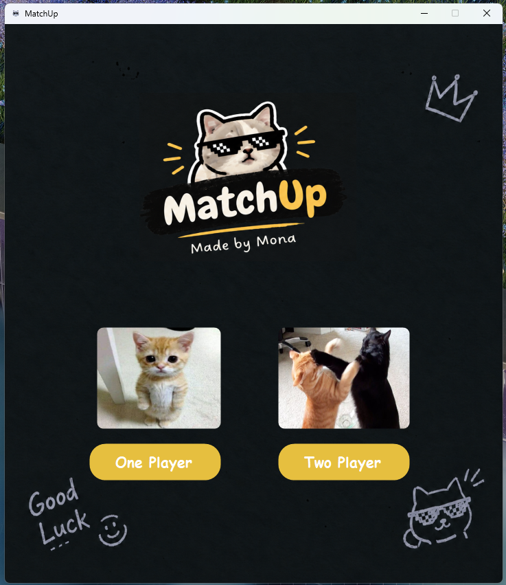
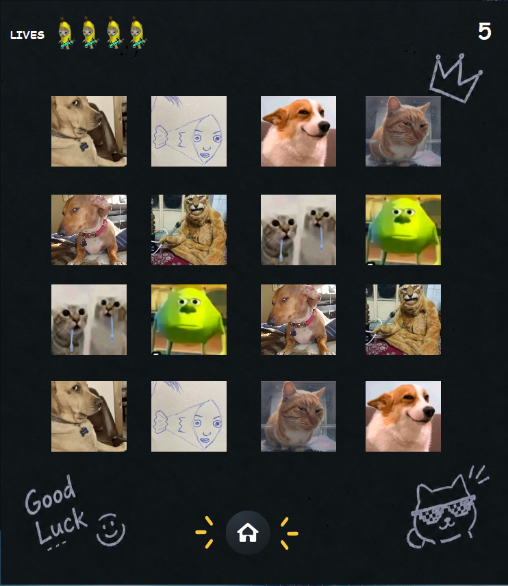
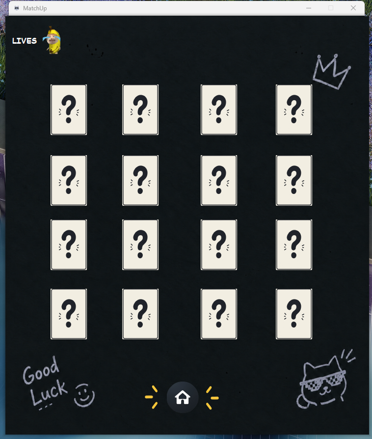

# MatchUp 🧠

Just a small project I made for fun and to practice C#. Nothing too serious. :)

The goal is to find all matching pairs of cards before running out of lives.

### What's in it?
- 16 cards to match
- Limited lives.
- A sound when you find a match

Game modes

The plan is to have single-player and two-player modes, but for now, only single-player is available.

### Built with
- C#
- Windows Forms
- Guna.UI2
- Windows Media Player for video playback

### Running the game

- Download the repository and extract the files.

- Open MatchUp.sln in Visual Studio.

- Build and run.
- Note: You might need to install Guna.UI2.WinForms if it's not already available in your setup.
  
---
## 📸 Preview
  
